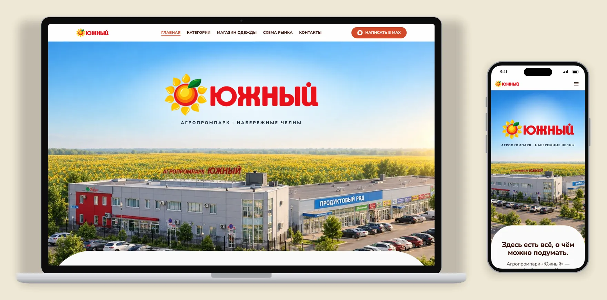
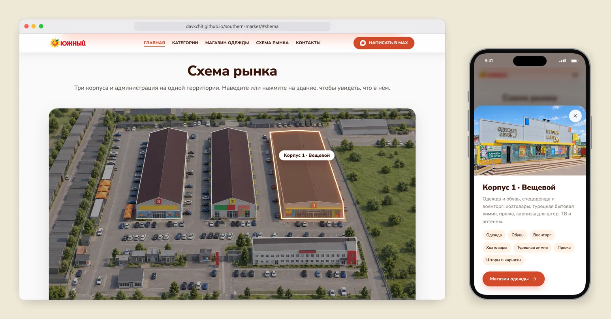
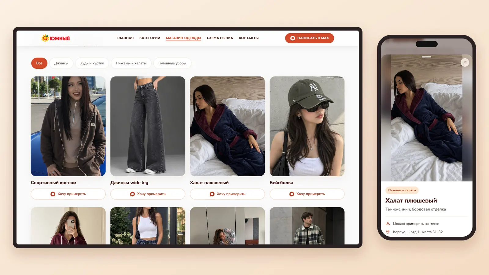
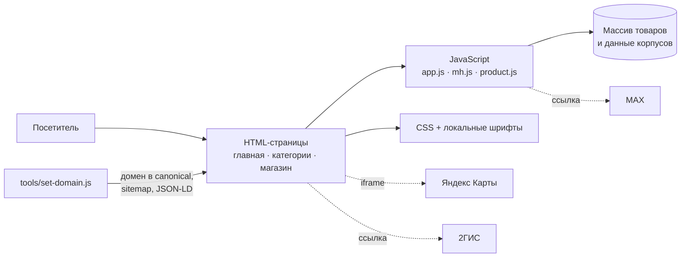

# Рынок «Южный»

Сайт-визитка агропромпарка «Южный» в Набережных Челнах и витрина магазина одежды, который работает на его территории.




**Статус:** пилот. Временная версия: [davkchit.github.io/southern-market](https://davkchit.github.io/southern-market/). Планируемый домен: рынок-южный-рт.рф.

## Задача

Рынок большой: три корпуса, администрация и больше десятка направлений, от продуктов до комбикорма. Человек, который ищет его в интернете, хочет быстро понять три вещи: что здесь продают, в каком корпусе нужный отдел и как сюда доехать. Сайт отвечает на это с первого экрана и с телефона.

Вторая часть сайта продвигает магазин одежды на рынке. Каталог с фильтрами, окно товара и кнопка «Хочу примерить», которая открывает чат в MAX. Покупатель выбирает вещь дома, а приходит уже за ней.

## Возможности

### Посетитель рынка



Главная страница и раздел категорий показывают 13 направлений рынка. На 3D-схеме корпус подсвечивается при наведении, а по нажатию открывается карточка: фото, что в нём продают, теги отделов. Ниже карта Яндекса, кнопки маршрута в Яндекс Картах и 2ГИС, часы работы.

### Покупатель магазина одежды



В каталоге 19 вещей и фильтры по разделам: джинсы, худи и куртки, пижамы и халаты, головные уборы. Карточка открывается окном, на телефоне это шторка снизу, её можно смахнуть пальцем. «Хочу примерить» ведёт в MAX и копирует готовый текст сообщения с названием вещи. Пошаговый фото-тур из пяти шагов показывает дорогу от арки до магазина.

### Владелец

Товары лежат одним массивом в `assets/js/app.js`: категория, название, описание, имя фото. Ссылка на MAX задаётся в одной строке там же. Домен для поисковиков меняется одной командой (`tools/set-domain.js`).

## Ключевые решения

**Интерактивная схема поверх картинки.** Корпуса обведены SVG-многоугольниками в координатах исходного изображения, слой масштабируется вместе с фото. Наведение на здание, фокус с клавиатуры и кнопки под схемой подсвечивают один и тот же корпус. На телефоне наведения нет, поэтому контуры там видны всегда. Минус: координаты сняты вручную, при замене картинки их придётся снимать заново.

**Связь через MAX.** Каналом связи выбран MAX, а не WhatsApp. В отличие от wa.me, у MAX нет ссылки с готовым текстом. Сайт по нажатию копирует текст в буфер и показывает подсказку «вставьте его в чат». Минус: у покупателя на один шаг больше, а копирование работает только по https.

**SEO под локальный поиск.** Своя разметка Schema.org на каждой странице: рынок как ShoppingCenter с координатами и часами, магазин одежды как ClothingStore внутри него, хлебные крошки, список категорий. Lighthouse SEO на страницах категорий и магазина вырос с 92 до 100. Домен в canonical, sitemap и разметку подставляет скрипт, кириллический .рф он сам переводит в punycode. Минус: карточки товаров собираются в браузере из JavaScript, в исходном HTML их нет.

**Скорость на мобильном.** Фото пережаты, у крупных есть уменьшенные копии для телефонов, шрифты лежат на сайте, тяжёлый виджет Яндекс Карт грузится только при прокрутке к нему. Вес главной упал с 5,3 до 1,2 МБ, оценка скорости в Lighthouse у магазина поднялась с 0 до 89. Ноль был из-за анимации появления: Chrome не находил на странице главное содержимое. Минус: картинки на сайте всё ещё в JPEG, до WebP или AVIF руки пока не дошли.

**Окно товара с физикой.** На компьютере окно вырастает из нажатой карточки, на телефоне выезжает шторкой. Анимация на пружине, её можно перехватить пальцем в любой момент. Отдельно правил Safari на iPhone: он сужал фото в окне и обрезал свечение логотипа. Минус: своя реализация вместо готовой библиотеки, её нужно поддерживать самому.

## Разработка

Сайт сделан одним человеком с ИИ-ассистентом (Claude Code), код написан ассистентом. Первая версия появилась 29 сентября 2026, эта ветка проекта ведётся с 9 октября.

Моя часть: дизайн и визуальный стиль, решения по продукту (что показывать на сайте, MAX как канал связи, акцент на магазине одежды), постановка задач ассистенту, проверка каждого результата на компьютере и iPhone, правки по итогам. 3D-схему рынка я сгенерировал нейросетью по спутниковому снимку и уличным фото, ассистент помог составить промпт.

## Архитектура



HTML, CSS и JavaScript без фреймворков и сборки. Хостинг сейчас GitHub Pages, для боевого хостинга готов `.htaccess`.

## Запуск

```bash
git clone https://github.com/davkchit/southern-market.git
cd southern-market
npx serve .
# открыть http://localhost:3000
```

Подробности о структуре, домене, хостинге и SEO: [docs/ARCHITECTURE.md](docs/ARCHITECTURE.md).

## Автор

David Kacheishvili · [github.com/davkchit](https://github.com/davkchit)
